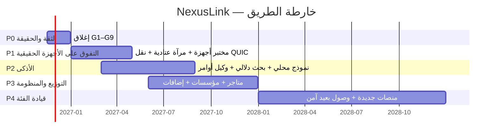

# NexusLink — خارطة الطريق 2026-11 → 2028: من «منتج مكتمل محليًا» إلى «الأقوى والأذكى عالميًا»

> كُتبت في 2026-11-15 بعد اختبار v3.1.0 فعليًا في بيئة معزولة، وإصلاح وإطلاق v3.1.1.
> هذه الخارطة **مكمّلة** لـ `docs/ROADMAP.md` (العقود والعتبات) و`docs/MASTER-PLAN.md`، ولا تلغيهما.
> مبدؤها: **كل ادعاء في README أو الموقع يجب أن يثبته فحص آلي أو جهاز حقيقي**. «الأفضل في العالم» لا يُعلَن، بل يُقاس.

---

## 1) أين نقف اليوم (بصراحة)

**نقاط القوة الحقيقية**
- نطاق ميزات أوسع من أي منافس منفرد: حافظة، نقل ملفات مستأنف، تحكم، مرآة إشعارات ورسائل، روتينات، كاميرا افتراضية، SDK وCLI.
- محلي بلا حسابات ولا سحابة، مع تشفير X25519 + AES-256-GCM.
- خط إصدار آلي لخمس منصات مع توقيع تحديثات Tauri و`latest.json`. أثبت نفسه في v3.1.1.
- انضباط اختبار عالٍ (آلاف فحوص E2E) وتوثيق عقود.

**الفجوات التي وجدها الاختبار الفعلي (يجب إغلاقها قبل أي توسع)**

| # | الفجوة | الأثر |
|---|---|---|
| G1 | البوابة تستمع على كل الواجهات ورمز الاقتران **معطّل افتراضيًا**. تأكد وصول غير موثّق من الشبكة | أمني حرج |
| G2 | الخادم المحزوم يُظهر **أجهزة وبيانات تجريبية** (galaxy-s24، pc-office…) عبر `prod-seed.ts` حتى مع قاعدة نظيفة | ثقة المستخدم من أول دقيقة |
| G3 | ادعاء «صفر اتصالات خارجية» بينما APK يحتوي ML Kit/Firebase | تناقض علني |
| G4 | APK بحجم ~120MB، و`minSdk 24` (Android 7) بينما README يقول Android 8+ | تبنٍّ وتوثيق |
| G5 | أذونات Accessibility/Overlay بلا مسار امتثال واضح لسياسة Google Play | يمنع النشر في Play |
| G6 | لا بناء Linux arm64، ولا توقيع Windows (OV/EV) ولا Notarization لماك | تحذيرات أمان عند التثبيت |
| G7 | صفحات الخطأ تكشف مسارات داخلية، وترويسات أمان ناقصة في بعض المسارات | أمني متوسط |
| G8 | أرقام متضاربة: E2E 2108 في الموقع مقابل 1954 في README | مصداقية |
| G9 | `release.yml` ينشر الإصدار **مباشرة** (ليس مسودة)، وفشل منصة واحدة ترك إصدارًا ناقصًا علنيًا | خطر تشغيلي |
| G10 | المرآة والاقتران الحقيقي والتحكم لم تُختبر على أجهزة حقيقية في CI | جودة غير مقاسة |
| G11 | «المساعد الذكي» حتمي (قواعد) بلا نموذج لغوي محلي فعلي | الذكاء ادعاء أكثر منه واقع |

---

## 2) ماذا يعني «الأفضل في العالم» — مقاييس مقابل المنافسين

| المحور | المرجع الأقوى اليوم | هدف NexusLink (قابل للقياس) |
|---|---|---|
| مرآة الشاشة والتحكم | scrcpy | زمن end-to-end ≤ 35ms p95 على Wi-Fi 5GHz، و1080p60 بترميز عتادي H.264/H.265/AV1 |
| نقل الملفات | LocalSend / Quick Share | ≥ 90% من سرعة الشبكة النظرية، واستئناف بعد انقطاع بلا فقد |
| التكامل مع الهاتف | Phone Link / KDE Connect | مكالمات ورسائل وإشعارات وحافظة وصور خلال ≤ 1s، على Windows وماك ولينكس معًا |
| الخصوصية | KDE Connect / LocalSend | صفر اتصال خارجي مُثبت بفحص شبكة آلي على كل إصدار، والبوابة مغلقة افتراضيًا |
| الذكاء | Copilot / Apple Intelligence (سحابية جزئيًا) | نموذج محلي اختياري يعمل بلا إنترنت: بحث دلالي، تلخيص إشعارات، أوامر طبيعية، OCR |
| التبنّي | AirDroid | أول قيمة خلال ≤ 30 ثانية من التثبيت، وتثبيت بلا أي تحذير أمني |
| الموثوقية | — | معدل جلسات بلا انهيار ≥ 99.8% (بتقارير محلية اختيارية) |

---

## 3) المراحل

### P0 — الثقة والحقيقة (2026-11-16 → 2026-12-31) · الإصدارات 3.1.x → 3.2.0
هدفها أن يكون كل ما نقوله صحيحًا، وأن يكون الوضع الافتراضي آمنًا.

1. **البوابة آمنة افتراضيًا (G1):** رمز الاقتران إلزامي لأي واصل غير loopback، ويحمله QR الاقتران تلقائيًا. الاستماع على LAN فقط عند تفعيل «اتصال الأجهزة»، مع فحص E2E يثبت رد 401 من عنوان LAN بلا رمز.
2. **لا بيانات تجريبية للمستخدمين (G2):** البذور التجريبية خلف `NEXUSLINK_DEMO=1` فقط (للعرض والاختبارات)، والتثبيت الجديد يبدأ فارغًا مع شاشة «اربط أول جهاز».
3. **صدق «صفر سحابة» (G3):** استبدال ML Kit بمسح QR محلي (ZXing) وOCR محلي (Tesseract)، وإزالة Firebase، مع فحص آلي في CI يرفض أي SDK سحابي داخل APK.
4. **APK أخف (G4):** APK مقسّم لكل معمارية (arm64 ≈ 40–50MB) + AAB لمتجر Play. توحيد الحد الأدنى: Android 8 (minSdk 26) أو تصحيح README.
5. **امتثال Play (G5):** نكهتان: `play` بلا Accessibility/Overlay (مع إفصاح)، و`full` للتوزيع المباشر وF-Droid.
6. **تثبيت بلا تحذيرات (G6):** شهادة Windows (Azure Trusted Signing أو OV)، وApple Developer ID + Notarization، وبناء Linux arm64 وAppImage له.
7. **تقوية الويب (G7):** صفحات خطأ عامة، وCSP وX-Frame-Options وReferrer-Policy على كل المسارات، مع فحص آلي للترويسات.
8. **رقم واحد للحقيقة (G8):** عدد فحوص E2E يُولَّد آليًا من CI في ملف `metrics.json` يقرؤه README والموقع.
9. **إصدار آمن (G9):** `release.yml` ينشئ **مسودة** دائمًا، ولا يُنشر الإصدار إلا عند نجاح كل المنصات وبموافقة يدوية (environment protection).
10. **نظافة المستودع:** حماية فرع `main` (PR + فحوص إلزامية)، ورموز GitHub دقيقة النطاق قصيرة العمر، وإزالة ملفات القوالب المتبقية.

**بوابة الخروج:** تثبيت نظيف على Windows/ماك/لينكس/أندرويد بلا تحذير ولا بيانات وهمية، والبوابة ترفض الوصول غير الموثّق، وفحص الشبكة يثبت صفر اتصال خارجي.

### P1 — التفوق على الأجهزة الحقيقية (2027-01 → 2027-04) · 3.3 → 3.5
1. **مختبر أجهزة ذاتي الاستضافة:** 4–6 هواتف حقيقية (Samsung، Pixel، Xiaomi، أندرويد 8 إلى الأحدث) متصلة بـ runner خاص، تشغّل اختبارات الاقتران والمرآة والنقل كل ليلة.
2. **مرآة بمستوى scrcpy أو أفضل:** MediaCodec عتادي، ونقل عبر UDP/QUIC بتحكم ازدحام، ولوحة قياس زمن حية. الهدف ≤ 35ms p95.
3. **نقل ملفات QUIC متعدد المسارات:** استئناف كتلي وتحقق BLAKE3 وتوازي، وهدف ≥ 90% من سرعة الشبكة.
4. **اكتشاف لا يفشل:** mDNS + بث UDP + اقتران QR/رمز رقمي، مع وضع شبكة الضيوف و«نقطة اتصال الهاتف».
5. **iOS بصدق:** تطبيق مرافق للملفات والحافظة والصور عبر Share Extension، مع توضيح الحدود على الموقع.
6. **تقارير انهيار محلية اختيارية:** تُحفظ على الجهاز ويرسلها المستخدم بنفسه، دون أي تتبع.

**بوابة الخروج:** المقاييس في القسم 2 (المرآة والنقل والاكتشاف) مثبتة ليليًا على 4 أجهزة حقيقية.

### P2 — الأذكى (2027-03 → 2027-08) · 3.6 → 4.0
1. **محرك ذكاء محلي اختياري:** حزمة نموذج تُنزَّل بموافقة صريحة (llama.cpp بنموذج صغير 1–4B مضغوط)، ويستفيد من NPU/GPU عند توفره (DirectML، Metal، Vulkan).
2. **بحث دلالي عبر كل الأجهزة:** فهرس متجهات محلي (sqlite-vec) للملفات والصور (وصف محلي) والرسائل والحافظة. «ابحث عن فاتورة الكهرباء التي صوّرتها الشهر الماضي».
3. **فرز وتلخيص الإشعارات والرسائل:** تجميع ذكي، و«أهم 5 أشياء فاتتك»، واقتراح ردود، كلها محليًا.
4. **وكيل أوامر بلغة طبيعية:** «أرسل آخر 10 صور لجهاز المكتب وفعّل وضع عدم الإزعاج» ينفَّذ بخطة مرئية وتأكيد قبل كل إجراء حساس.
5. **روتينات تقترح نفسها:** من نمط الاستخدام المحلي («كل يوم 9 صباحًا تفتح المجلد نفسه، أؤتمته؟»).
6. **صوت محلي:** Whisper محلي للإملاء والأوامر، بالعربية أولًا.
7. **OCR وترجمة محلية:** نسخ النص من صورة على الهاتف إلى حافظة الكمبيوتر فورًا.

**بوابة الخروج:** المساعد يجيب 90% من مجموعة اختبار من 200 أمر عربي وإنجليزي بلا إنترنت، وبزمن ≤ 1.5s على جهاز متوسط.

### P3 — التوزيع والمنظومة (2027-06 → 2027-12) · 4.x
1. **قنوات رسمية:** Microsoft Store وwinget وHomebrew Cask وFlathub وSnap وF-Droid وGoogle Play.
2. **مؤسسات:** حزم MSI/PKG للنشر الجماعي، وسياسات مركزية (تعطيل ميزات، فرض رموز)، وتقارير امتثال محلية.
3. **سوق إضافات موقّع:** SDK مستقر 2.x، وصندوق رمل للإضافات، و20 تكاملًا (Home Assistant، Obsidian، OBS…).
4. **وصول بعيد آمن اختياري:** ترحيل ذاتي الاستضافة أو WireGuard/Tailscale، مع تشفير طرفي، بلا خادم مركزي لنا.
5. **مجتمع:** ترجمة مفتوحة، ومكافآت ثغرات، وبرنامج تجريبي (beta channel) عبر `latest.json` منفصل.

### P4 — قيادة الفئة (2028)
- منصات جديدة: Wear OS والتلفاز والسيارة (Android Auto) ولينكس على ARM/RISC-V.
- تدقيق أمني خارجي مستقل منشور علنًا، ثم SOC 2 / ISO 27001 للمسار المؤسسي.
- شراكات OEM بوضع «خصوصية افتراضية».

---

## 4) مؤشرات تُنشر علنًا كل إصدار

| المؤشر | الآن | P0 | P1 | P2 |
|---|---|---|---|---|
| وصول غير موثّق من LAN | ممكن | 0 | 0 | 0 |
| اتصالات خارجية في التثبيت الافتراضي | ML Kit/Firebase | 0 | 0 | 0 |
| حجم APK (arm64) | ~120MB | ≤ 50MB | ≤ 45MB | ≤ 45MB (بلا النموذج) |
| زمن المرآة p95 | غير مقاس على جهاز حقيقي | قياس أولي | ≤ 35ms | ≤ 35ms |
| أول قيمة بعد التثبيت | غير مقاس | ≤ 60s | ≤ 30s | ≤ 20s |
| تحذيرات التثبيت | ماك وويندوز | 0 | 0 | 0 |
| أجهزة حقيقية في الاختبار الليلي | 0 | 1 | 4+ | 6+ |
| دقة المساعد بلا إنترنت | قواعد فقط | — | — | ≥ 90% |

---

## 5) قواعد العمل الهندسي (من الآن)
1. كل تغيير عبر فرع وPR، ولا دمج إلا بفحوص خضراء.
2. الإصدارات مسودة أولًا، ولا تُنشر إلا بعد التحقق من الأصول و`latest.json`.
3. كل ميزة جديدة تحتاج: قياسًا، واختبار E2E، وتوثيقًا صادقًا لحدودها، وترجمة.
4. لا ادعاء تسويقي بلا فحص آلي يثبته.
5. مراجعة شهرية لهذه الخارطة، ومراجعة ربعية للمؤشرات.

## 6) أول ما يُنفَّذ (Sprint 1 — يبدأ 2026-11-15)
- [x] إصلاح خط الإصدار (اعتمادات comms-service، Flutter analyze، روابط ويندوز) — PR #24 و#25.
- [x] إطلاق v3.1.1 بالشعار الجديد وفيديو الجولة — PR #23 و#26.
- [x] `release.yml`: إصدار مسودة دائمًا + نشر فقط بعد نجاح كل المنصات (G9).
- [x] البذور التجريبية خلف `NEXUSLINK_DEMO` (G2).
- [x] رقم E2E موحد مولَّد آليًا (G8).
- [ ] البوابة: رمز اقتران إلزامي لغير loopback، يحمله QR (G1). **ينتظر موافقة المالك لأنه يغيّر طريقة الاقتران.**
