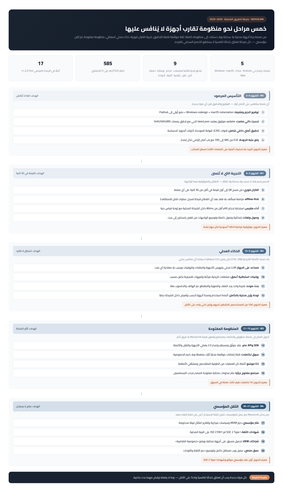

# NexusLink — خارطة الطريق الشاملة (2026 – 2029)

> الوثيقة التنفيذية الكاملة (نفس المحتوى بصيغة مستند رسمي) في: `download/NexusLink-خارطة-الطريق-الشاملة.docx`
> الإصدار المرجعي عند التدوين: **v1.2.0-fix2** — أكتوبر 2026 — مراجعة ربعية إلزامية.
> آخر مراجعة ربعية: **2026-10-20 (الأولى — اجتياز مع تحفظات خارجية)** — الوثيقة: `download/NexusLink-المراجعة-الربعية-Q4-2026.docx`.

## نجم الشمال

أجهزة المستخدم يد واحدة موثوقة — **محليًا، خاصًا، بلا وسيط**. أي عمل هندسي لا يقرب المنتج من هذه الجملة يُؤجل أو يُرفض.

## عقيدة الخارطة

كل ميزة جديدة يجب أن تعمّق خندقًا تنافسيًا واحدًا على الأقل — وما لا يفعله يُرفض مهما بدت جاذبيته.

## الخنادق التنافسية الخمسة

| # | الخندق | عتبة «لا يُنافَس» |
|---|--------|--------------------|
| 1 | الخصوصية المعمارية (لا سحابة ولا حسابات) | خصوم سحابيون لا يستطيعون حذف وسيطهم |
| 2 | عمق التكامل الرأسي عبر المنصات | منافس يبدأ من الصفر لكل منصة |
| 3 | محرك الأتمتة التاريخية (§26–§27) | تاريخ قياس متراكم لا يُنسخ بالشراء |
| 4 | البنية بلا حسابات (تبنٍّ صفري الاحتكاك) | لا مقابل لدى الاشتراكات السحابية |
| 5 | إيقاع الإصدار المقاس (CI خماسي + E2E) | ثقة مكتسبة لا تُبنى بسرعة |

## المراحل الخمس

### M0 — التأسيس المرصود (الشهور 0–3) · الهدف: ثقة لا تُناقش
1. توقيع الحزم ونشرها: Windows codesign + macOS notarization + دفع أولي إلى Flathub.
2. تحديث ذاتي صامت يعتمد `latest.json` الحي مع تحقق بصمات `SHA256SUMS`.
3. تدقيق أمني داخلي شامل: قنوات E2EE، البوابة الموحدة، أذونات أندرويد الحساسة.
4. رفع عتبة الجودة: E2E من 585 إلى **700** — **منجز (700/700 — M1-Q700: قسم UPD للتحديث الذاتي وسجل الإصدارات + قسم DEV-LC لعمق الاقتران ودورة حياة الأجهزة)**.
- **معيار الخروج:** تثبيت بلا تحذيرات أمنية على المنصات الثلاث لسطح المكتب.

### M1 — التجربة التي لا تُنسى (الشهور 3–9) · الهدف: القيمة في 30 ثانية
1. اقتران فوري: من مسح QR إلى أول قيمة في أقل من 30 ثانية على أي منصة — **منجز (PAIR M1.1 — عقد §30: تسييل زمني بثلاث طوابع QR→pair→أول قيمة مرسَّخ في SQLite (PairMetric) + `GET /api/pair-metrics` بإحصاء أقرب-رتبة (آخر/متوسط/p95/أقصى/اجتياز) + لوحة حية على الويب (شارة عتبة 30ث + لوحة موسّعة وسجل آخر الاقترانات) وبطاقة على الهاتف بترجمات ar/en — بيانات وصفية حصرًا حرس F6 متوافق — E2E +16 فحصًا حيًا ومصدرًا)**.
2. offline-first: مزامنة تستأنف بلا فقد بعد أي انقطاع (سجل عمليات قابل للاستئناف) — **منجز (SYNC M1.2 — عقد §28: ProdOpLog بتسلسل رتيب + prod:resume/replay/ack بمؤشرات العملاء + حرس F6 على التاريخ + صندوق صادر E2EE للعصور الرجيعية — E2E +22 فحصًا حيًا ومصدرًا)**.
3. أداء مقيس: استجابة تحكم p95 أقل من 80ms داخل الشبكة المحلية بلوحة قياس حية — **منجز (PERF M1.3 — عقد §29: ختم `__m` على الأوامر المتقطعة + إقرار `rc:ack` من جسر الكمبيوتر بحرس دور F8 + نافذة منزلقة 240 بمئين أقرب-رتبة + لوحة حية (شارة p95 ولوحة موسّعة على الويب ورقاقة على الهاتف) — RTT حقيقي ذهاب-إياب عبر البوابة والمرحّل حتى تطبيق الجسر — E2E +17 فحصًا حيًا ومصدرًا)**.
4. إمكانية وصول كاملة + توسيع اللغات من لغتين إلى ست — **منجز (LANG-A11Y M1.4 — عقد §31: ست لغات ar RTL + en/fr/es/de/ru بسجل معاقد وسلسلة سقوط lang→en→raw وتحميل كسول للمعاجم — مولّد قواميس مفهرس قابل للاستئناف (درس ترجمة المفاتيح المختلطة) — تغطية متدرجة موثقة عند الإغلاق: fr/es 98% · de 62% · ru 69% قابلة للاستكمال بلا تغيير كود + الهاتف 619/619 للغات الأربع كلها بمنتقي رقائق مشترك — الإتاحة: واجهة حجم الخط (فجوة مغلقة) + حلقات تركيز دائمة + رابط تخطٍّ عبر المحرك + أسماء يسرية كاملة — E2E +18 فحصًا (مصدر + حي عبر /api/i18n-status بيانات وصفية حصرًا))**.
5. عتبة الجودة M1: E2E من 700 إلى **900** — **منجز (DEEP-AUDIT 906/906 مرتين متتاليتين — تدقيق عمق ما بعد المراجعة الربعية بستة أقسام +126 فحصًا: SYNC-DEEP دلالات سجل العمليات وحدوده — شطدات المؤشرات (بلا حزمة/نص/سالب/عائم/فوق الرأس) وتكرار opId idempotent وعملاء مستقلان بنوافذ متباينة ودفعة 205 مقطوعة (أول 200 + truncated ثم استمرار بالمؤشر حتى الاستنفاد) وأرضية 400 = min(الرأس, 400) بالتفريغ الكامل الدقيق) + PERSIST بقاء السجل عبر إيقاف SIGKILL وإعادة إقلاع كاملة للخادم والجسور (الرأس والنافذة مطابقان حرفيًا لقبل الإيقاف — إثبات حي أن السجل أقدم من العملية — جوهر offline-first) + PERF-DEEP رياضيات المئين أقرب-رتبة بـ23 خاصية (الحدود 79/80 · الذيل يحكم · آخر زمني لا أصغر) + PAIR-DEEP رياضيات §30 والاتساق الحي للـAPI + LANG-DEEP نظافة المعاجم الحقيقية الأربع (بلا بقايا عربية ولا فراغ) وسقوط map(en) ببيانات مفاتيح غائبة عن de (1,322) + EDGE-NEG شطدات البوابة (3000/3001/3010/8180/abc → 403 والسماح ≠ الوجود) والجسر (لا انهيار) — درسان معماريان موثقان: prod:hello يُبث عند الاتصال حصرًا فالمراقبة الموثوقة عبر resume→replay الذي يرد دائمًا، والدفعات المتوازية تُدرج بترتيب اكتمال appendOp لا ترتيب الإرسال (الضمانة: المجموعة الكاملة + الرتيب بالseq لا التسلسل الحرفي)**.
- **معيار الخروج:** موثوقية مزامنة 99.9% أسبوعيًا لكل جهاز نشط. عتبة E2E: **900 — بلُغت (906)**.

### M2 — الذكاء المحلي (الشهور 9–15) · الهدف: استباق لا تقليد
1. مساعد على الجهاز (LLM محلي) يفهرس الأجهزة والملفات والروتينات — بلا مغادرة أي بايت. — **منجز (ASSISTANT M2.1 — عقد §33.ب: NLU حتمي بخمس نوايا (status/find/suggest/explain/help) بإجابات مسببة من الفهرس المحلي مع تصريح المصادر + محول LLM محلي اختياري بحرس نطاق صارم 127.0.0.1 حصرًا (Ollama/llama.cpp — كشف 600ms وتصفية آمنة تعيد النص الحتمي عند الفشل) — في هذه البيئة بلا مُشغّل فيخدم المحرك الحتمي كاملًا بصدق (`llm.available=false`) — لوحة محادثة بعرض الذكاء الجديد)**
2. روتينات استباقية أعمق: مشغلات تاريخية مركبة + تنبيهات تفسيرية بذليل مسبب. — **منجز (COMPOSITE M2.2 — عقد §33.ج: `trigger.and` تاريخي أولًا حصرًا + شرط حالة من قائمة COMPOSITE_STATE_KINDS يُقيَّم كحالة الآن عند اكتمال التاريخ — تعشيش/لحظي أول/نوع خارج القائمة مرفوضة مسببًا — الدليل «الدليل:» يُخزَّن داخل detail المرسوخ فتبقى التنبيهات بعد إعادة التشغيل بذليلها (صفر تغيير مخطط) والمساعد explain يقرأه — حقبة لا تُستهلك إلا بالإطلاق الفعلي — محرر بصف AND وشارة دمج)**
3. بحث موحد عبر الهاتف والحاسوب من شريط واحد. — **منجز (UNIFIED-SEARCH M2.3 — عقد §33.أ: searchAll فوق ثمانية مخازن محلية (أجهزة/روتينات/حافظة/رسائل/جهات/نداءات/تسليم/ملفات متزامنة) بدرجات بادئة>احتواء>تسلسل وسقوف 8/40 — `GET /api/search` + نافذة موحدة (Ctrl+Shift+F أو زر الشريط) بتجميع بالمصدر وقفزة للعرض — صفر بايت يغادر)**
4. لوحة رؤى استخدام محلية بالكامل. — **منجز (INSIGHTS M2.4 — عقد §33.د: `GET /api/insights` تجميعات من الجداول القائمة حصرًا — عمليات وإطلاقات 14 يومًا بسلسلة يومية متصلة + حافظة ومزامنة ورسائل ومقاييس §30 وأعلى الأجهزة — أرقام وأزمنة وأحجام حصرًا (F6 متوافق) — أشرطة CSS خالصة بلا اعتماد رسومي في تبويب الرؤى)**
- **معيار الخروج:** 50% من المستخدمين النشطين بروتين ذكي واحد على الأقل — **طبقة الذكاء الأساسية مكتملة (§33)؛ القياس الحي يتطلب مستخدمين فعليين (بعد النشر الخارجي)**. عتبة E2E الجديدة: أساس 945 = 906 + 39 INTEL.

### M3 — المنظومة المفتوحة (الشهور 15–21) · الهدف: تأثير الشبكة
1. SDK وAPI عام موثق بإصدار العقد 2.0 (الأجهزة والنقل والأتمتة).
2. سوق تكاملات: قناة إضافات موقعة محليًا تُثبَّت بضغطة.
3. CLI موسّع: كل عملية قابلة للأتمتة من الطرفية.
4. مجتمع مفتوح جزئيًا: مكونات مختارة مفتوحة المصدر.
- **معيار الخروج:** 10 تكاملات طرف ثالث عاملة + دليل مطور 2.0 كامل.

### M4 — الثقل المؤسسي (الشهور 21–30) · الهدف: منتج لا يستبدل
1. نشر مؤسسي: حزم MDM وسياسات مركزية وتقارير امتثال.
2. شهادات الثقة: SOC 2 Type I ثم ISO 27001 على البنية المحلية.
3. شراكات OEM: تحميل مسبق بوضع «خصوصية افتراضية».
4. عمق منصي: عميل ويب مستقل كامل + توسيع TV واللوحات.
- **معيار الخروج:** أول عقد مؤسسي موقّع + شهادة SOC 2 Type I.

## الحوكمة وإيقاع الإصدار

- **الإيقاع:** minor شهري عبر CI الخماسي + major ربعي يرفع عتبات الجودة.
- **باب الميزة (إلزامي):** اسم الخندق + حدود صادقة موثقة (نمط §26) + اختبارات E2E + تغطية i18n — ما ينقصه بندًا لا يدخل الإصدار.
- **الترقيم:** 1.x = M0/M1 · 2.0 (مع SDK) = M3 · 3.0 = M4.
- **البوابات:** بناء أخضر خماسي · عتبة E2E تصاعدية · باب أمان (توقيع + بصمات) · توثيق · ترجمة.

## سجل المخاطر الرئيسي

| الخطر | الأثر | التخفيف |
|-------|-------|---------|
| قيود iOS على الوصول المنخفض | مرتفع | عميل PWA محدود + الحاسوب مقصود لمستخدمي أبل — صراحة بلا وعود |
| كلفة توقيع Apple والتحقق | متوسط | انضمام مبكر لبرنامج المطور في M0 |
| عوائق المتاجر | متوسط | توزيع مباشر موقّع أولًا ثم Flathub فالمتاجر الأوسع |
| بطء التبني أمام علامات كبرى | مرتفع | فئة مبكرة جدية + قصص استخدام لا يستطيع الكبار سردها |
| فريق هندسي واحد | مرتفع | أتمتة CI + افتتاح مجتمع مفتوح جزئي في M3 |
| تذبذب بيئة التشغيل | منخفض | قواعد ops المرسخة: الإقلاع الدائم عبر `.zscripts/dev.sh` حصرًا |

## مؤشرات القياس (خط الأساس → الأهداف)

| المؤشر | الأساس اليوم | نهاية M1 | نهاية M4 |
|--------|--------------|----------|----------|
| فحوص E2E الخضراء | 945 (M1 مكتمل + M2.1–M2.4 — أساس 700 تجاوز بـ+245: SYNC 22 + PERF 17 + PAIR 19 + LANG 21 + DEEP 126 + INTEL 39 (16 مصدرًا + 23 حيًا)) | 900 بلُغت وتجاوزت | 1200+ |
| زمن الاقتران حتى أول قيمة | دقائق (يدوي) | < 30 ثانية | < 20 ثانية |
| موثوقية المزامنة الأسبوعية | غير مقاسة | 99.9% | 99.95% |
| استجابة التحكم p95 محليًا | غير مقاسة | < 80ms | < 50ms |
| تكاملات السوق | — | — | 10+ |
| قنوات التوزيع الرسمية | صفحة النشر (حية — v1.2.0-fix2) | 3 | 5+ (مع OEM) |

> المؤشرات تُراجع ربعيًا مع المخاطر؛ أي مؤشر يتراجع ربعين متتاليين يستدعي قرار إعادة تمويل أو إعادة نطاق.

## الخطوات الفورية (أول 30 يومًا)

1. توقيع Windows + برنامج Apple/notarization آليًا في سير الإصدار.
2. تدقيق أمني داخلي بقائمة فحص مكتوبة → بنود عمل مغلقة.
3. رفع E2E: 585 → 700 بتغطية التحديث والاقتران — **منجز (700/700)**.
4. حزمة Flathub ودفعها للمراجعة.
5. حلقة تغذية راجعة مبكرة موثقة في صفحة النشر.
6. اعتماد هذه الخارطة مرجعًا حيًا — مراجعة ربعية في سجل العمل — **منجز (المراجعة الأولى 2026-10-20: اجتياز مع تحفظات خارجية — سجل المراجعات أدناه)**.

## سجل المراجعات الربعية

| الدورة | التاريخ | الحكم | أبرز القرارات | الوثيقة |
|--------|---------|-------|----------------|----------|
| الأولى (تأسيسية) | 2026-10-20 | اجتياز مع تحفظات خارجية | اعتماد أساس E2E 700 · بلا إعادة نطاق · تثبيت القرارات الملكية الخمسة كمسار لفتح البنود المعلقة | download/NexusLink-المراجعة-الربعية-Q4-2026.docx |

> الدورة القادمة: **يناير 2027** — مقارنة ضد أساس 700 وتفعيل القياسات الحية لبنود M1 (اقتران أقل من 30 ثانية، وp95، وموثوقية المزامنة).
