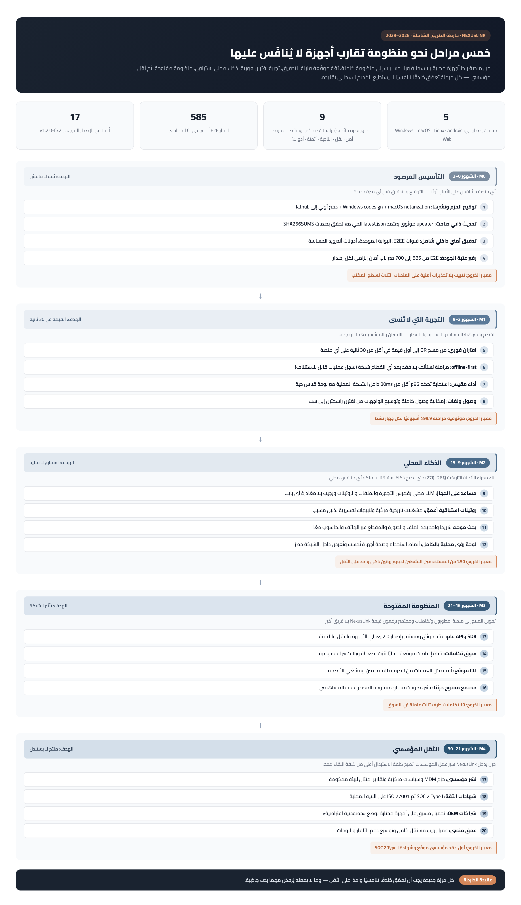

# NexusLink — خارطة الطريق الشاملة (2026 – 2029)

> الوثيقة التنفيذية الكاملة (نفس المحتوى بصيغة مستند رسمي) في: `download/NexusLink-خارطة-الطريق-الشاملة.docx`
> الإصدار المرجعي عند التدوين: **v1.2.0-fix2** — أكتوبر 2026 — مراجعة ربعية إلزامية.
> آخر مراجعة ربعية: **2026-10-20 (الأولى — اجتياز مع تحفظات خارجية)** — الوثيقة: `download/NexusLink-المراجعة-الربعية-Q4-2026.docx`.

## الخارطة الموحدة 2026–2030 — المرجع الاستراتيجي المعتمد

> **اعتمدت** (بند نهاية الشهر الأول — 30 يومًا) الوثيقة الموحدة التي تدمج المنجز
> المؤسّس (أعلاه) مع الأفق الثلاثي على أربعة محاور (تبنٍّ · مؤسسي · دخل · توسّع):
> **`download/NexusLink-خارطة-التطوير-الموحدة-2026-2030.pdf`** (+ مصدرها `html`).
> هذه الوثيقة (الأسفل) تبقى **مصدر الحقيقة الهندسي** للعقود والعتبات، والخارطة الموحدة **مرآة القرار الاستراتيجي** فوقها — والثلاث وثائق (هذا الملف · MASTER-PLAN · الخارطة الموحدة) تُحدّث معًا عند كل مراجعة ربعية بلا تناقض.

| المرحلة | النافذة | الهدف المكثف | بوابة الخروج |
|---|---|---|---|
| المنجز M0→M3 | حتى أكتوبر 2026 | منتج مكتمل محليًا بجودة مثبتة | مغلق — v3.1.0 · 1,316 فحصًا |
| **P1 الإطلاق الرسمي** | 2026Q4 ← 2027H1 | توزيع رسمي بلا احتكاك (توقيع · Flathub · دومين · مجتمع) | 1,000 تحميل + 4 قنوات + مراجعة يناير 2027 |
| **P2 المؤسسي والدخل** | 2027H2 ← 2028 | أول عملاء وأول دخل (MDM · SOC 2 · فئة Pro · متاجر) | أول عقد موقّع + SOC 2 Type I + Pro بالتحقق المحلي |
| **P3 التوسع** | 2029 | فريق (2–3) · أول OEM · ISO 27001 · سوق 50 تكاملًا | فريق 3+ + عقد OEM + 50 تكاملًا |
| **P4 الاستدامة** | 2030 | دخل ذاتي · حوكمة مجتمعية · قيادة فئة | دخل يغطي فريق 3+ ربعين متتاليين |

**القاعدة الملزمة للترقيم بعد استهلاك «3.0 = M4»:** minor شهري على 3.x خلال P1، ثم major عند كل بوابة خروج — v4.0 مع خروج P2 (2028)، وv5.0 مع خروج P3 (2029) — رقم الإصدار علامة مائية للبوابة لا للمرحلة.

**القرارات الملكية الثلاثة المعلقة (D2)** — حُضّرت مذكراتها بالخيارات والتوصيات المسببة وتنتظر التوقيع الكتابي: **`docs/decisions/`** (D2-1 أرشيف pre-rewrite · D2-2 بداية M4 · D2-3 سياسة تدوير رموز الاقتران).

**تنفيذ غير-النشري من اليوم الأول (2026-10-30):** فحص أسرار كامل التاريخ — صفر أسرار (التقرير: `docs/security-history-scan.md` · الأداة: `scripts/secret-scan.mjs` · حرس CI: `.github/workflows/security.yml`) · `SECURITY.md` مع الإبلاغ الأمني الخاص مفعّل · Discussions بقوالب مجتمع · بنود النشر (شهادات/Flathub/دومين/متاجر) مؤجلة بأمر المالك.

**موجة التنافس المباشر (2026-10-30 — عقود §50–§52 — لا نشر ولا وسم):** ثلاث ميزات جديدة كاملة تضرب أقوى المنافسين مباشرة، كلٌّ يعمّق خندقًا معلنًا: **§50 خزنة الحافظة الذكية** (مقابل Win+V/Pushbullet/KDE — تصنيف حساسية محلي بـLuhn + إخفاء تلقائي + انتهاء 15د للحساس و7 أيام للعادي + تدبيس + لصق مؤقت + بحث بدلالات §33.أ) · **§51 المشاركة الضيوفة المباشرة** (مقابل LocalSend/AirDrop — استقبال بمتصفح الطرف الآخر حصرًا بلا تطبيق ولا حساب، رمز مؤقت 5–120د، محلي بلا وسيط، قفل محاولات نمط §37) · **§52 وضع التركيز الموحد** (مقابل Apple Focus/Phone Link — كتم موحد للتعكيس وعدم الإزعاج بانتهاء ذاتي واستعادة الحالة السابقة حتميًا بلا مؤقتات). التوثيق الكامل: `docs/enterprise-deploy.md` (الأقسام 19–21) — **E2E ‏+128 = أساس 1444 بجولتين متتاليتين أخضرتين لكل بوابة** (بوابات: `scripts/clip-vault-e2e.mjs` · `guest-share-e2e.mjs` · `focus-e2e.mjs` بإقلاع `boot-e50`) · i18n ‏3,792×5 (+67) · tsc على الأساس 24 · بناء إنتاجي أخضر · أدلة حية: `scripts/evidence/g5*.png`.

**موجة التنافس المباشر الثانية (2026-11-09 — عقود §53–§55):** **§53 التسليم اليدوي الذكي** (مقابل Apple Handoff/Microsoft «متابعة على الحاسوب»/Pushbullet Push — دفع رابط أو نص أو مرجع ملف أو موضع وسائط من الهاتف إلى الحاسوب محليًا بلا حساب ولا وسيط، معاينات مقنّعة بتآزر §50، استهلاك بفعل بنقرة، قائمة ≤50 و≤24س بتكرار ذكي، مشغل روتينات `handoff.arrived` فوق ناقل الحقائق، 7 أنواع تدقيق §39 بلا محتوى) · **§54 الدرع الاحتياطي المشفّر** (مقابل AirDroid/Google Backup — مغلف AES-256-GCM على الجهاز حصرًا بمشتق PBKDF2 بـ600,000 تكرار + صندوق مزدوج يفرّق التلف من العبارة الخاطئة + جدولة بمفتاح محلي مرسوخ DesktopSetting لا يعود أبدًا + احتفاظ حتمي + استخراج مكتبة التصدير/الاستعادة المشتركة صفر ازدواج) · **§55 الماسح الموثق الحي** (مقابل Adobe Scan/Google Drive — صفحات JPEG من الهاتف تُدمج في PDF على حاسوب المالك حرفيًا: مرور نقي بلا معالجة صور ودوران بتحويل إحداثيات بلا فقد + مولد PDF مكتفٍ ذاتيًا بنمط §47 + جلسات على القرص بلا زومبي + فحص سحر JPEG حرفيًا) — التوثيق: `docs/enterprise-deploy.md` §22–§24 — **E2E ‏+102 = أساس 1546 بجولتين متتاليتين أخضرتين لكل بوابة** (`handoff-e2e` ‏40 · `backup-secure-e2e` ‏31 · `scan-e2e` ‏31 بإقلاع `boot-e55`) · i18n ‏3,845×5 (+53) **مع إصلاح انجراف التطابق الكامل §42 الموروث** · tsc 24 · lint نظيف · بناء إنتاجي أخضر.

**موجة الوكيل المحمول (2026-11-09 — عقد §56 — إغلاق العمل المعلن من §53/§55):** الجسر الكامل في وكيل Flutter: **«أرسل إلى الحاسوب»** (عميل `handoffPush` بتحقق محلي مرآة للسيرفر + شاشة إرسال بهدف حي وعداد سقوف حقيقي) · **«الماسح الموثق» في الجيب** (دورة open → page → seal كاملة من الهاتف: رفع JPEG متعدد بفحص سحر محلي مرآة · تدوير · إعادة ترتيب صفرية الأساس · ختم بحوار يعرض مسار PDF على الكمبيوتر) · **مشاركة أندرويد → الحاسوب بنقرة** (زر «إلى الحاسوب» في بطاقة المشاركات الواردة — أي رابط تشاركه من أي تطبيق يهبط جرس §53) — التحقق: **بوابة `agent-bridge-e2e` الجديدة 23/23 × جولتين** (boot-e56) + انحدار §53 ‏40×2 و§55 ‏31×2 · i18n الوكيل **669×6** متطابقة الشجرة · `dart analyze` بلا أخطاء نحوية · tsc 24 · lint نظيف · بناء إنتاجي أخضر — التوثيق: `docs/enterprise-deploy.md` §25 — حدود صادقة معلنة: الالتقاط بالكاميرا (image_picker) وعتبة/OCR عمل لاحق.

**موجة القفل الساكن (2026-11-09 — عقد §57 — إغلاق العمل المعلن من §53):** **قفل التسليم الساكن HANDOFF-AT-REST** — حمولات قائمة التسليم اليدوي لا تُكتب على القرص نصًّا عاريًا أبدًا: مغلف AES-256-GCM لكل حمولة (علامة handoff.at-rest · IV طازج كل ختم · وسم مصادقة مستقل — درس GCM الموثق: بلا setAuthTag لا فتح) بمفتاح محلي 32 بايت مرسوخ DesktopSetting صفر-مخطط لا يعود في أي API ولا يُعرض أبدًا (خلاف §54 — القفل داخلي حصرًا) · ترحيل صامت للنص العاري القديم عند أول كتابة · إسقاط فردي صادق للقناغة المسمومة مع تدقيق §39 والقائمة تبقى حية · تدوير rotate-key بحرس loopback يعيد الختم كاملًا · شارة قفل حية في جرس §53 — التحقق: **بوابة handoff-rest-e2e ‏28/28 × جولتين** (قراءة القرص مباشرة: لا نص عاري ولا رابط خام) + بطارية الانحدار كاملة §39–§56 بلا إخفاق · i18n ‏3,849×5 كليًا بحارس أ27 محدث · tsc 24 · lint نظيف · بناء إنتاجي أخضر — التوثيق: `docs/enterprise-deploy.md` §26 — الحد المعلن الباقي: قفل خزنة الحافظة (ProdClip) في القاعدة عمل لاحق معلن.

**موجة قفل الخزنة الساكن (2026-11-09 — عقد §58 — إغلاق الحد الموروث من §50/§57):** **قفل الخزنة الساكن CLIP-AT-REST** — محتوى خزنة الحافظة ProdClip لا يُكتب في قاعدة SQLite نصًّا عاريًا أبدًا: **قفص التخزين الساكن الموحد** at-rest-cage (تعميم صفر-ازدواج لنواة §57 — كل مستقبل لاحق يأخذ قفصه بعلامته) بقفص `clip.at-rest` بسقف محسوب 16.8MB وأدنى قناغة 1 بايت (درس GCM التدفقي: حرس §57 الـ16 كان يُسقط رموز OTP الستّية) — مفتاح DesktopSetting صفر-مخطط لا يعود في أي API ولا يُعرض حتى عند التدوير — الختم في مسارات الكتابة الثلاثة (API §11 · سوكِت clip:push · حقن الروتينات) والقراءة شفافة في القوائم والبحث (دلالات §33.أ فوق المغلفات) والكشف — **سجل العمليات ProdOpLog مغلّف أيضًا** والإعادة المحلية تُفك شفافًا — ترحيل صامت عند أول قراءة + «ختم السجل» بإرادة صريحة + تدوير rotate-key بحرس loopback — العبث يُسقط صفه حصرًا مع تدقيق §39 والقائمة حية — البذرة نظيفة من المفتاح (لا مفاتيح مسافرة في git) — التحقق: **بوابة clip-rest-e2e ‏39/39 × جولتين** (أ نقي 15 + ب حي 24 يقرأ بايتات SQLite مباشرة: القاعدة وسجل العمليات بلا نص عاري والإعادة عبر سوكِت 3007 الحي شفافة) — الانحدارات بلا إخفاق: §50 ‏52×4 · §53 ‏40×6 · §57 ‏28×2 · §54 ‏31×4 · §55 ‏31×4 · §56 ‏23×2 · §51 ‏45×2 · §52 ‏31×2 · §48 ‏52 · §39 ‏20 — tsc ‏24 · lint نظيف · فاحص الأسرار نظيف · بناء إنتاجي أخضر — التوثيق: `docs/enterprise-deploy.md` §27 — أساس E2E: **1574 → 1613 (+39)**.

## نجم الشمال

أجهزة المستخدم يد واحدة موثوقة — **محليًا، خاصًا، بلا وسيط**. أي عمل هندسي لا يقرب المنتج من هذه الجملة يُؤجل أو يُرفض.

## عقيدة الخارطة

كل ميزة جديدة يجب أن تعمّق خندقًا تنافسيًا واحدًا على الأقل — وما لا يفعله يُرفض مهما بدت جاذبيته.

## الخنادق التنافسية الخمسة

| # | الخندق | عتبة «لا يُنافَس» |
|---|--------|--------------------|
| 1 | الخصوصية المعمارية (لا سحابة ولا حسابات) | خصوم سحابيون لا يستطيعون حذف وسيطهم |
| 2 | عمق التكامل الرأسي عبر المنصات | منافس يبدأ من الصفر لكل منصة |
| 3 | محرك الأتمتة التاريخية (§26–§27) | تاريخ قياس متراكم لا يُنسخ بالشراء |
| 4 | البنية بلا حسابات (تبنٍّ صفري الاحتكاك) | لا مقابل لدى الاشتراكات السحابية |
| 5 | إيقاع الإصدار المقاس (CI خماسي + E2E) | ثقة مكتسبة لا تُبنى بسرعة |

## المراحل الخمس

### M0 — التأسيس المرصود (الشهور 0–3) · الهدف: ثقة لا تُناقش
1. توقيع الحزم ونشرها: Windows codesign + macOS notarization + دفع أولي إلى Flathub — **نوى التوقيع منجزة (عقد §43): مقاعد الأسرار والاستيراد والحقن والتحقق الحي داخل CI في release.yml — نائمة بغياب الشهادات، تتفعل لحظة قرار المالك**.
2. تحديث ذاتي صامت يعتمد `latest.json` الحي مع تحقق بصمات `SHA256SUMS`.
3. تدقيق أمني داخلي شامل: قنوات E2EE، البوابة الموحدة، أذونات أندرويد الحساسة.
4. رفع عتبة الجودة: E2E من 585 إلى **700** — **منجز (700/700 — M1-Q700: قسم UPD للتحديث الذاتي وسجل الإصدارات + قسم DEV-LC لعمق الاقتران ودورة حياة الأجهزة)**.
- **معيار الخروج:** تثبيت بلا تحذيرات أمنية على المنصات الثلاث لسطح المكتب.

### M1 — التجربة التي لا تُنسى (الشهور 3–9) · الهدف: القيمة في 30 ثانية
1. اقتران فوري: من مسح QR إلى أول قيمة في أقل من 30 ثانية على أي منصة — **منجز (PAIR M1.1 — عقد §30: تسييل زمني بثلاث طوابع QR→pair→أول قيمة مرسَّخ في SQLite (PairMetric) + `GET /api/pair-metrics` بإحصاء أقرب-رتبة (آخر/متوسط/p95/أقصى/اجتياز) + لوحة حية على الويب (شارة عتبة 30ث + لوحة موسّعة وسجل آخر الاقترانات) وبطاقة على الهاتف بترجمات ar/en — بيانات وصفية حصرًا حرس F6 متوافق — E2E +16 فحصًا حيًا ومصدرًا)**.
2. offline-first: مزامنة تستأنف بلا فقد بعد أي انقطاع (سجل عمليات قابل للاستئناف) — **منجز (SYNC M1.2 — عقد §28: ProdOpLog بتسلسل رتيب + prod:resume/replay/ack بمؤشرات العملاء + حرس F6 على التاريخ + صندوق صادر E2EE للعصور الرجيعية — E2E +22 فحصًا حيًا ومصدرًا)**.
3. أداء مقيس: استجابة تحكم p95 أقل من 80ms داخل الشبكة المحلية بلوحة قياس حية — **منجز (PERF M1.3 — عقد §29: ختم `__m` على الأوامر المتقطعة + إقرار `rc:ack` من جسر الكمبيوتر بحرس دور F8 + نافذة منزلقة 240 بمئين أقرب-رتبة + لوحة حية (شارة p95 ولوحة موسّعة على الويب ورقاقة على الهاتف) — RTT حقيقي ذهاب-إياب عبر البوابة والمرحّل حتى تطبيق الجسر — E2E +17 فحصًا حيًا ومصدرًا)**.
4. إمكانية وصول كاملة + توسيع اللغات من لغتين إلى ست — **منجز (LANG-A11Y M1.4 — عقد §31: ست لغات ar RTL + en/fr/es/de/ru بسجل معاقد وسلسلة سقوط lang→en→raw وتحميل كسول للمعاجم — مولّد قواميس مفهرس قابل للاستئناف (درس ترجمة المفاتيح المختلطة) — تغطية متدرجة موثقة عند الإغلاق: fr/es 98% · de 62% · ru 69% قابلة للاستكمال بلا تغيير كود — **واستُكملت فعلًا (عقد §42): الأربع كاملة 3,623/3,623 مفتاحًا باستئناف المولّد نفسه بلا تغيير كود، وصفر بقايا عربية، والحارس يفرض التطابق الكامل آليًا** + الهاتف 619/619 للغات الأربع كلها بمنتقي رقائق مشترك — الإتاحة: واجهة حجم الخط (فجوة مغلقة) + حلقات تركيز دائمة + رابط تخطٍّ عبر المحرك + أسماء يسرية كاملة — E2E +18 فحصًا (مصدر + حي عبر /api/i18n-status بيانات وصفية حصرًا))**.
5. عتبة الجودة M1: E2E من 700 إلى **900** — **منجز (DEEP-AUDIT 906/906 مرتين متتاليتين — تدقيق عمق ما بعد المراجعة الربعية بستة أقسام +126 فحصًا: SYNC-DEEP دلالات سجل العمليات وحدوده — شطدات المؤشرات (بلا حزمة/نص/سالب/عائم/فوق الرأس) وتكرار opId idempotent وعملاء مستقلان بنوافذ متباينة ودفعة 205 مقطوعة (أول 200 + truncated ثم استمرار بالمؤشر حتى الاستنفاد) وأرضية 400 = min(الرأس, 400) بالتفريغ الكامل الدقيق) + PERSIST بقاء السجل عبر إيقاف SIGKILL وإعادة إقلاع كاملة للخادم والجسور (الرأس والنافذة مطابقان حرفيًا لقبل الإيقاف — إثبات حي أن السجل أقدم من العملية — جوهر offline-first) + PERF-DEEP رياضيات المئين أقرب-رتبة بـ23 خاصية (الحدود 79/80 · الذيل يحكم · آخر زمني لا أصغر) + PAIR-DEEP رياضيات §30 والاتساق الحي للـAPI + LANG-DEEP نظافة المعاجم الحقيقية الأربع (بلا بقايا عربية ولا فراغ) وسقوط map(en) ببيانات مفاتيح غائبة عن de (1,322) + EDGE-NEG شطدات البوابة (3000/3001/3010/8180/abc → 403 والسماح ≠ الوجود) والجسر (لا انهيار) — درسان معماريان موثقان: prod:hello يُبث عند الاتصال حصرًا فالمراقبة الموثوقة عبر resume→replay الذي يرد دائمًا، والدفعات المتوازية تُدرج بترتيب اكتمال appendOp لا ترتيب الإرسال (الضمانة: المجموعة الكاملة + الرتيب بالseq لا التسلسل الحرفي)**.
- **معيار الخروج:** موثوقية مزامنة 99.9% أسبوعيًا لكل جهاز نشط. عتبة E2E: **900 — بلُغت (906)**.

### M2 — الذكاء المحلي (الشهور 9–15) · الهدف: استباق لا تقليد
1. مساعد على الجهاز (LLM محلي) يفهرس الأجهزة والملفات والروتينات — بلا مغادرة أي بايت. — **منجز (ASSISTANT M2.1 — عقد §33.ب: NLU حتمي بخمس نوايا (status/find/suggest/explain/help) بإجابات مسببة من الفهرس المحلي مع تصريح المصادر + محول LLM محلي اختياري بحرس نطاق صارم 127.0.0.1 حصرًا (Ollama/llama.cpp — كشف 600ms وتصفية آمنة تعيد النص الحتمي عند الفشل) — في هذه البيئة بلا مُشغّل فيخدم المحرك الحتمي كاملًا بصدق (`llm.available=false`) — لوحة محادثة بعرض الذكاء الجديد)**
2. روتينات استباقية أعمق: مشغلات تاريخية مركبة + تنبيهات تفسيرية بذليل مسبب. — **منجز (COMPOSITE M2.2 — عقد §33.ج: `trigger.and` تاريخي أولًا حصرًا + شرط حالة من قائمة COMPOSITE_STATE_KINDS يُقيَّم كحالة الآن عند اكتمال التاريخ — تعشيش/لحظي أول/نوع خارج القائمة مرفوضة مسببًا — الدليل «الدليل:» يُخزَّن داخل detail المرسوخ فتبقى التنبيهات بعد إعادة التشغيل بذليلها (صفر تغيير مخطط) والمساعد explain يقرأه — حقبة لا تُستهلك إلا بالإطلاق الفعلي — محرر بصف AND وشارة دمج)**
3. بحث موحد عبر الهاتف والحاسوب من شريط واحد. — **منجز (UNIFIED-SEARCH M2.3 — عقد §33.أ: searchAll فوق ثمانية مخازن محلية (أجهزة/روتينات/حافظة/رسائل/جهات/نداءات/تسليم/ملفات متزامنة) بدرجات بادئة>احتواء>تسلسل وسقوف 8/40 — `GET /api/search` + نافذة موحدة (Ctrl+Shift+F أو زر الشريط) بتجميع بالمصدر وقفزة للعرض — صفر بايت يغادر)**
4. لوحة رؤى استخدام محلية بالكامل. — **منجز (INSIGHTS M2.4 — عقد §33.د: `GET /api/insights` تجميعات من الجداول القائمة حصرًا — عمليات وإطلاقات 14 يومًا بسلسلة يومية متصلة + حافظة ومزامنة ورسائل ومقاييس §30 وأعلى الأجهزة — أرقام وأزمنة وأحجام حصرًا (F6 متوافق) — أشرطة CSS خالصة بلا اعتماد رسومي في تبويب الرؤى)**
- **معيار الخروج:** 50% من المستخدمين النشطين بروتين ذكي واحد على الأقل — **طبقة الذكاء الأساسية مكتملة (§33)؛ القياس الحي يتطلب مستخدمين فعليين (بعد النشر الخارجي)**. عتبة E2E الجديدة: أساس 945 = 906 + 39 INTEL.

### M3 — المنظومة المفتوحة (الشهور 15–21) · الهدف: تأثير الشبكة
1. SDK وAPI عام موثق بإصدار العقد 2.0 (الأجهزة والنقل والأتمتة) — **منجز (OPEN-API M3.1 — عقد §34.أ: `sdk/index.mjs` عميل ESM صفر-اعتماد بحرس محلي صارم في البناء (نفس حرس §33.ب) + واجهات REST عامة جديدة: `/api/automation/rules` (فوق مقبس الجسر — صفر ازدواج تحقق) و`/api/sync/ops` (قراءة حصرًا بلا حمولات F6) — دليل المطور 2.0 كامل: docs/sdk-guide.md)**.
2. سوق تكاملات: قناة إضافات موقعة محليًا تُثبَّت بضغطة — **منجز (MARKET M3.2 — عقد §34.ب: نموذج «تصريحي لا تنفيذي» بلا أي كود يُثبَّت + توقيع HMAC-SHA256 على الشكل المتعارف بـtimingSafeEqual + كتالوج قدرات مغلق (7) والغريب يرفض + مفتاح قناة محلي يرسخ صفر-مخطط في DesktopSetting وبصمته معلنة + قناة بداية **10 تكاملات موقعة** (معيار الخروج مكتمل) + بطاقة الإعدادات بتثبيت/إزالة بنقرة)**.
3. CLI موسّع: كل عملية قابلة للأتمتة من الطرفية — **منجز (CLI M3.3 — عقد §34.ج: `cli/nexus.mjs` صفر-اعتماد يعيد استخدام الـSDK (أول تكامل فعلي فوقه) — 16 أمرًا: status/devices/ops/search/ask/insights/automation×4/market×4/health/version/transfers بأعلام --port/--url/--json)**.
4. مجتمع مفتوح جزئيًا: مكونات مختارة مفتوحة المصدر — **منجز (OPEN-COMPONENTS M3.4 — عقد §34.د: docs/OPEN-COMPONENTS.md يصرّح بالمجموعة المفتوحة (pair-math · oplog · sdk/ · cli/ · الدليل) بترخيص MIT وحدود استقرار تعاقدية — النواة تبقى مغلقة حتى قرار الحوكمة — E2E يتحقق أن كل مسار معلن موجود فعلًا)**.
- **معيار الخروج:** 10 تكاملات طرف ثالث عاملة + دليل مطور 2.0 كامل — **مكتمل (قناة بداية 10 تكاملات موقعة عاملة على القنوات القائمة حرفيًا + docs/sdk-guide.md كامل بعقد §34 — إصدار العقد 2.0)**. عتبة E2E الجديدة: أساس 989 = 945 + 44 M3.

### DEEP — عمق ما بعد M3 (عقد §35) · إغلاق الحدود المعلنة
1. قناة الناشر المركزية (إغلاق حد §34.هـ.1): سجل ناشرين صفر-مخطط بتدوير مفاتيح بإصدارات يحفظ القديم وإبطال لحظي — **منجز (PUB §35.أ: غلاف pub بثنائية التوقيع على القناة كلها + تثبيت بمسارين + بصمات معلنة بلا مفاتيح)**.
2. الفرض اللحظي للقدرات (إغلاق حد §34.هـ.2): أصل قاعدة origin.plugin + بابا الإنشاء والإطلاق — **منجز (ENFORCE §35.ب: isPluginLive مصدر الحقيقة + توقف بصدق ok=false مسبب + الإحياء يحفظ الأصل + REST run بإقرار ack بعد الحسم)**.
3. التنبؤ الاستباقي (عمق M2 الاختياري المعلن): محرك حتمي صفر-مخطط — **منجز (PREDICT §35.ج: توقعات يومية/وسيط فترات من تاريخ الإطلاقات + اقتراحات مسبّبة بالدليل من العمليات والصحة + /api/predictions + تبويب «التنبؤ» الثالث — الإنشاء بيد المستخدم حصرًا)**.
- **معيار الخروج:** الحدود الثلاثة المعلنة مغلقة بفحوص حية — **مكتمل (E2E +36 = أساس 1025 = 989 + 36 DEEP — مرتين متتاليتين)**. عتبة E2E الجديدة: أساس 1025.

### GW — الوصول البعيد برمز اقتران (عقد §37) · إغلاق حد §36.هـ.1 (الطبقة المحلية)
1. تصميم الرموز وفرضها في البوابة: OFF-by-default + ملف صفر-مخطط بمقارنة زمن-ثابت وحجب تجريبي وإعفاء loopback/health وstrip للبارامتر وحسم WS — **منجز (PAIR §37: كل واصل من خارج الجهاز يحمل الرمز حين التمكين، والحسم لحظي من الملف بلا إعادة تشغيل)**.
2. إدارة بيد الجهاز حصرًا: `/api/remote-access` enable/rotate/disable بحرس loopback + بطاقة إعدادات (الرمز يُعرض مرة واحدة) + العميل الوِب يمرر الرمز ترويسةً — **منجز (ADMIN §37.د)**.
- **معيار الخروج:** حد §36.هـ.1 المقيد «لا يُفتح بلا تصميم رموز وتدقيق» مغلق محليًا بفحوص حية من عنوان LAN حقيقي — **مكتمل (E2E +29 = أساس 1074 = 1045 + 29 (28 GW + حرس الزومبي) — مرتين متتاليتين)**. عتبة E2E الجديدة: أساس 1074. يبقى خارجيًا: النفق/النطاق/TLS والنشر المؤسسي (M4).

### M4 — الثقل المؤسسي (الشهور 21–30) · الهدف: منتج لا يستبدل
1. نشر مؤسسي: حزم MDM وسياسات مركزية وتقارير امتثال.
2. شهادات الثقة: SOC 2 Type I ثم ISO 27001 على البنية المحلية.
3. شراكات OEM: تحميل مسبق بوضع «خصوصية افتراضية».
4. عمق منصي: عميل ويب مستقل كامل + توسيع TV واللوحات — **النواة المحلية منجزة (WEB §36: أثر ثابت صفر-بناء في `public/web-client/` — منظرٌ لا باب فوق الأسطح الثمانية القائمة حصرًا، صفر مسار API جديد وصفر طلب خارجي مفحوص — ترجمة مضمنة 114/114 متوازنة — PWA قابل للتثبيت display:standalone — وضع TV/لوحات قراءة حصرًا مفروض في العميل نفسه عبر حارس الجلب)**. طبقة الوصول برمز الاقتران المحلية منجزة (PAIR §37) — يبقى خارجيًا: النفق/النطاق/TLS مع العقد المؤسسي الأول.
- **معيار الخروج:** أول عقد مؤسسي موقّع + شهادة SOC 2 Type I.

## الحوكمة وإيقاع الإصدار

- **الإيقاع:** minor شهري عبر CI الخماسي + major ربعي يرفع عتبات الجودة.
- **باب الميزة (إلزامي):** اسم الخندق + حدود صادقة موثقة (نمط §26) + اختبارات E2E + تغطية i18n — ما ينقصه بندًا لا يدخل الإصدار.
- **الترقيم:** 1.x = M0/M1 · 2.0 (مع SDK) = M3 · 3.0 = M4.
- **البوابات:** بناء أخضر خماسي · عتبة E2E تصاعدية · باب أمان (توقيع + بصمات) · توثيق · ترجمة.

## سجل المخاطر الرئيسي

| الخطر | الأثر | التخفيف |
|-------|-------|---------|
| قيود iOS على الوصول المنخفض | مرتفع | عميل PWA محدود + الحاسوب مقصود لمستخدمي أبل — صراحة بلا وعود |
| كلفة توقيع Apple والتحقق | متوسط | انضمام مبكر لبرنامج المطور في M0 |
| عوائق المتاجر | متوسط | توزيع مباشر موقّع أولًا ثم Flathub فالمتاجر الأوسع |
| بطء التبني أمام علامات كبرى | مرتفع | فئة مبكرة جدية + قصص استخدام لا يستطيع الكبار سردها |
| فريق هندسي واحد | مرتفع | أتمتة CI + افتتاح مجتمع مفتوح جزئي في M3 |
| تذبذب بيئة التشغيل | منخفض | قواعد ops المرسخة: الإقلاع الدائم عبر `.zscripts/dev.sh` حصرًا |

## مؤشرات القياس (خط الأساس → الأهداف)

| المؤشر | الأساس اليوم | نهاية M1 | نهاية M4 |
|--------|--------------|----------|----------|
| فحوص E2E الخضراء | 1444 (M1–M3 + DEEP-§35 +36 + WEB-§36 +20 + GW-§37 +29 — أساس 700 تجاوز بـ+374 · ثم LICENSE-§45 +44 وASSIST-§46 +41 وENT-§47 +49 وEMG-§48 +52 وRELAY-§49 +58 — عتبة 1200 بلُغت · ثم موجة التنافس المباشر: VAULT-§50 +52 وGUEST-§51 +45 وFOCUS-§52 +31) | 900 بلُغت وتجاوزت | 1200+ بلُغت |
| زمن الاقتران حتى أول قيمة | دقائق (يدوي) | < 30 ثانية | < 20 ثانية |
| موثوقية المزامنة الأسبوعية | غير مقاسة | 99.9% | 99.95% |
| استجابة التحكم p95 محليًا | غير مقاسة | < 80ms | < 50ms |
| تكاملات السوق | — | — | 10+ |
| قنوات التوزيع الرسمية | صفحة النشر (حية — v1.2.0-fix2) | 3 | 5+ (مع OEM) |

> المؤشرات تُراجع ربعيًا مع المخاطر؛ أي مؤشر يتراجع ربعين متتاليين يستدعي قرار إعادة تمويل أو إعادة نطاق.

## الخطوات الفورية (أول 30 يومًا)

> **محدثة بالخارطة الموحدة (قسم 13) — الترتيب المقصود: الأمن أولًا بلا كلفة، ثم الشراءات، ثم الفتحات، ثم الإيقاع. بنود النشر (الشهادات/Flathub/الدومين/الإصدار v3.2) مؤجلة بأمر المالك (دعك من النشر) وتعود للفتح بقراره.**

1. إبطال رمز GitHub المسرّب + بديل بأقل نطاق وانتهاء قصير + تفعيل 2FA — **إجراء مالك (خارج المستودع)**.
2. فحص أسرار تاريخ المستودع والتأكد من صفر أسرار — **منجز (2026-10-30: شجرة 1,193 ملفًا + تاريخ 2,424 كتلة — صفر أسرار حقيقية · 130 استثناءً اختبارًا موثقًا بخط أساس · تقرير: `docs/security-history-scan.md` + حرس CI دائم)**.
3. سياسة أمان + قناة دعم عامة — **منجز (2026-10-30: `SECURITY.md` + الإبلاغ الأمني الخاص مفعّل + Discussions بقوالب Q&A/Ideas + قوالب Issue)**.
4. قرارات D2 الثلاثة كتابيًا — **حُضّرت مذكراتها بالخيارات والتوصيات: `docs/decisions/` — تنتظر توقيع المالك**.
5. اعتماد الخارطة الموحدة مرجعًا حيًا — **منجز (2026-10-30: قسم الاعتماد أعلاه + نسختا PDF/HTML في `download/`)**.
6. توقيع Windows OV + Apple Developer + إدخال الأسرار في مقاعد §43 — **مؤجل بأمر المالك (نشر)**.
7. Search Console تحقق + sitemap · حساب Flathub وفتح الطلب · الدومين وربطه — **مؤجل بأمر المالك (نشر)**.
8. إصدار v3.2 بالإيقاع الشهري — **مؤجل بأمر المالك (نشر) — لا وسم ولا إصدار حتى إشارة**.

## سجل المراجعات الربعية

| الدورة | التاريخ | الحكم | أبرز القرارات | الوثيقة |
|--------|---------|-------|----------------|----------|
| الأولى (تأسيسية) | 2026-10-20 | اجتياز مع تحفظات خارجية | اعتماد أساس E2E 700 · بلا إعادة نطاق · تثبيت القرارات الملكية الخمسة كمسار لفتح البنود المعلقة | download/NexusLink-المراجعة-الربعية-Q4-2026.docx |

> الدورة القادمة: **يناير 2027** — أول بوابة حكم خارجي على الخارطة الموحدة: مقارنة أساسها المؤشرات المعلنة فيها (E2E لا يقل عن 1,400 لنهاية P1 · قنوات التوزيع · زمن الاقتران) + حسم D2 الثلاثة الموقّعة + حالة بنود النشر المؤجلة.
